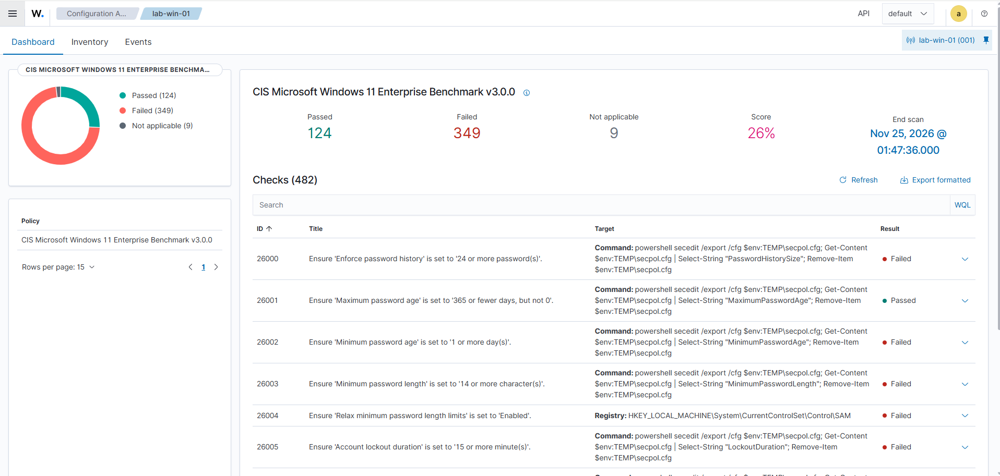

# Wazuh SIEM Lab

I deployed Wazuh on an Ubuntu 24.04 LTS VPS, enrolled a Windows
endpoint, and verified that the endpoint completed its first
Security Configuration Assessment (SCA).

## Architecture

- Ubuntu VPS: Wazuh Manager, Indexer, Dashboard, and Filebeat.
- Windows endpoint: Wazuh agent `lab-win-01`.
- Dashboard access: local SSH tunnel. The dashboard port is closed
  to inbound internet traffic at the cloud firewall.
- Agent connectivity: TCP 1515 for enrollment and TCP 1514 for
  agent communication, restricted to the authorized source IP.

## Deployment and validation

1. Provision an Ubuntu VPS and verify CPU, memory, and disk capacity.
2. Restrict inbound SSH to the authorized source IP and verify that
   a new SSH session works after applying the firewall.
3. Install Wazuh using the official all-in-one installation assistant.
4. Open the dashboard through a local SSH tunnel.
5. Enroll the Windows agent and verify its first SCA scan.

[Official Wazuh quickstart](https://documentation.wazuh.com/current/quickstart.html)

## Initial assessment results

Policy: CIS Microsoft Windows 11 Enterprise Benchmark v3.0.0.

| Result | Count |
| --- | ---: |
| Passed | 124 |
| Failed | 349 |
| Not applicable | 9 |
| Total checks | 482 |

The dashboard reported a 26% pass rate across applicable checks.
This is the initial configuration baseline for the lab endpoint.

## Example finding

**Check 26003 — Minimum password length.** The benchmark requires at
least 14 characters. Wazuh reported this check as failed. The proposed
follow-up is to verify the effective Windows password policy, assess
the impact of changing it, and rerun the scan after remediation.

## Related project

[Endpoint Coverage Check](https://github.com/LaloPaCh/endpoint-coverage-check)
uses Python to compare an asset inventory with monitoring records.
Collecting agent status directly from the Wazuh API is a planned extension.

